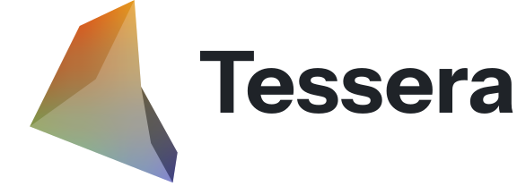

<p align="center">
  <picture>
    <source media="(prefers-color-scheme: dark)" srcset="docs/logo.svg">
    
  </picture>
</p>

<p align="center">
  A plugin-based tool to create Super Smash Bros. Ultimate mods.
</p>

<p align="center">
  <a href="https://skillicons.dev">
    
  </a>
</p>

## Development

Requires Node 22.12+ and Rust 1.90+.

```bash
npm install
npm run dev
```

Tests: `npm test` and `cargo test` in `apps/desktop/src-tauri`.

## Docs

- [Wiki](https://github.com/CompagesWorks/Tessera/wiki): installing and using Tessera
- [Writing a plugin](docs/plugins/README.md)
- [Discord](https://discord.gg/2zT5Rg46bG)

## Credits

UI by [Atrium-UI](https://github.com/CompagesWorks/Atrium-UI). Icons by [Bootstrap Icons](https://icons.getbootstrap.com/).
